# Statistics
This project is for my statiscal course in uni 3rd-semester.

Bog: Applied statistics and probability for engineers, 7th edition, by Douglas C, Montgomery * George C. Runner

All slides are made by Claus Vaarning

## Basic Definition of teorien af Sandsynlighed

Fra undervisning:

<p align="center"></p>


<p align="center"></p>


<p align="center"></p>


<p align="center"></p>


## Statistiks modellering


### Discrete random variables and probability distributions
Fra undervisning:

<p align="center"></p>


<p align="center"></p>


<p align="center"></p>


<p align="center"></p>

### Continuous random variables and probability distributions
Fra undervisning:

<p align="center"></p>


<p align="center"></p>


<p align="center"></p>


<p align="center"></p>


<p align="center"></p>


### Joint probability distributions
Fra undervisning:

<p align="center"></p>


<p align="center"></p>


<p align="center"></p>


<p align="center"></p>


<p align="center"></p>

## Estimation of model parameters

### Descriptive statistics Sampling distributions Point estimation
Fra undervisning:

<p align="center">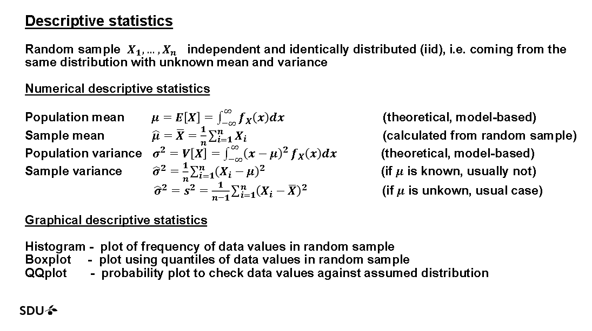</p>


<p align="center">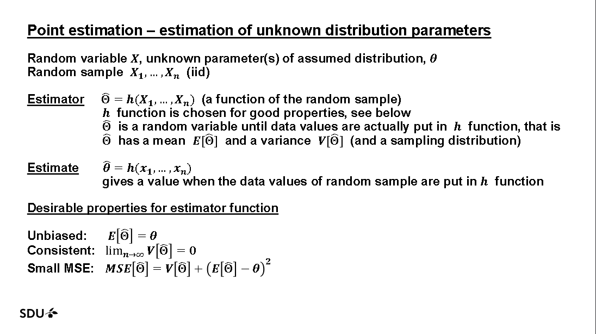</p>


<p align="center">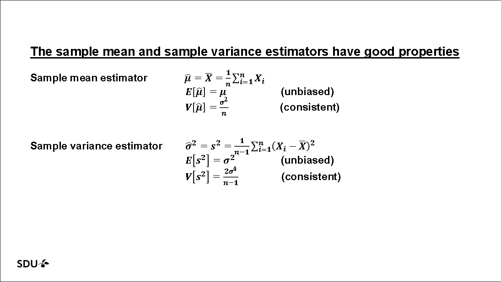</p>


<p align="center">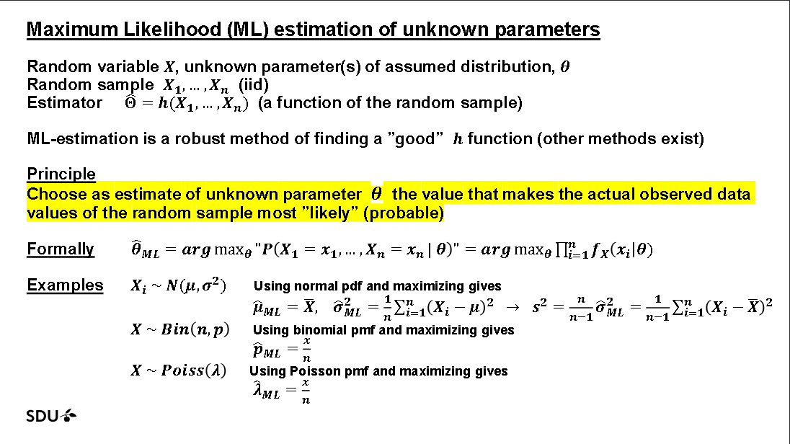</p>


### Interval estimation (confidence intervals)
Fra undervisning:

<p align="center"></p>


<p align="center"></p>


<p align="center"></p>


<p align="center"></p>


<p align="center"></p>


<p align="center"></p>


### One-sample hypothesis testing
Fra undervisning:

<p align="center">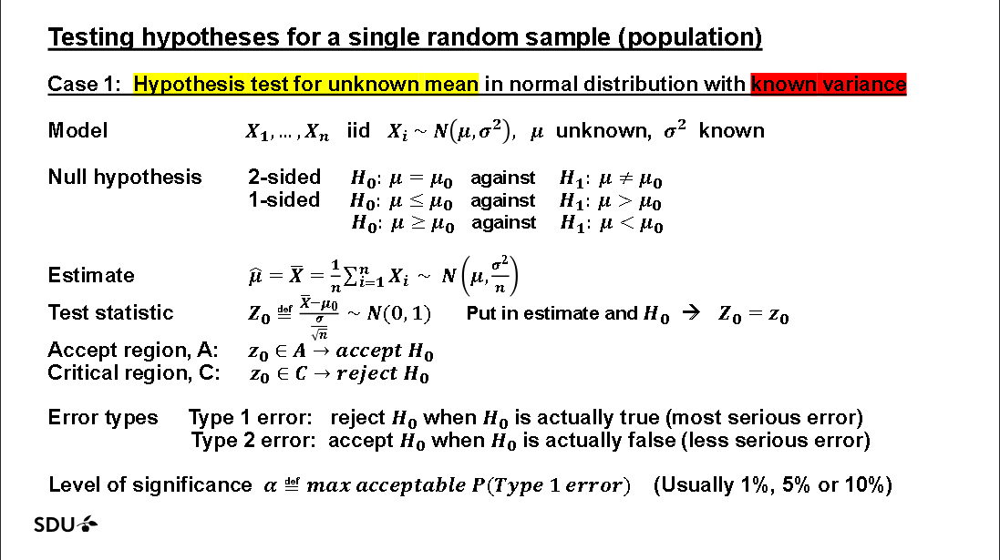</p>


<p align="center">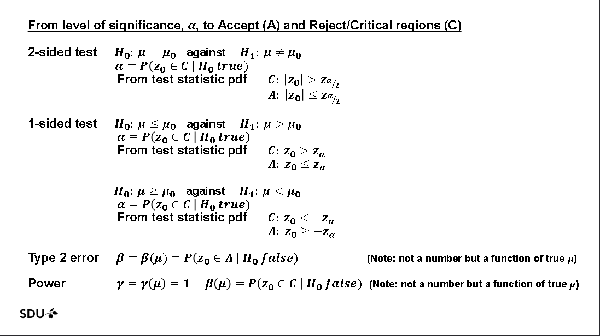</p>


<p align="center">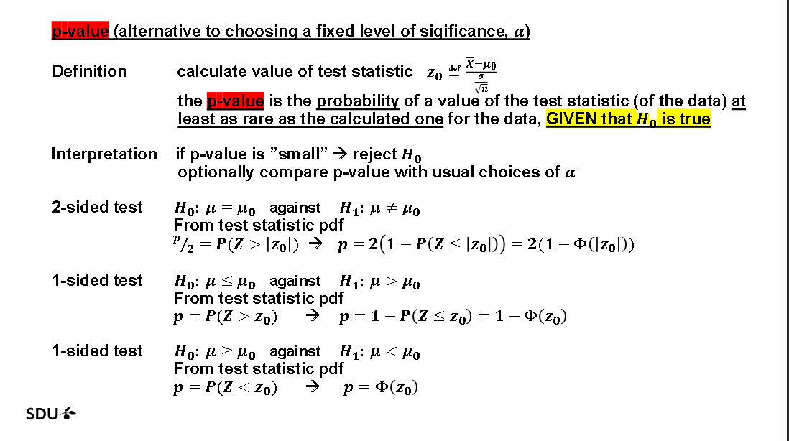</p>


<p align="center">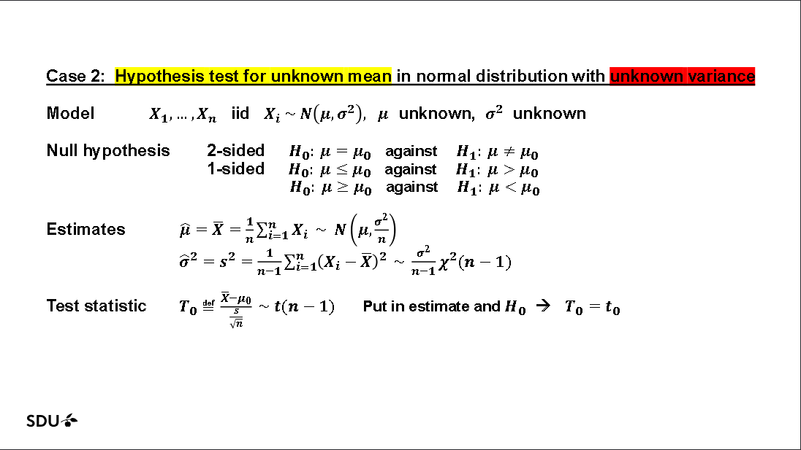</p>


<p align="center">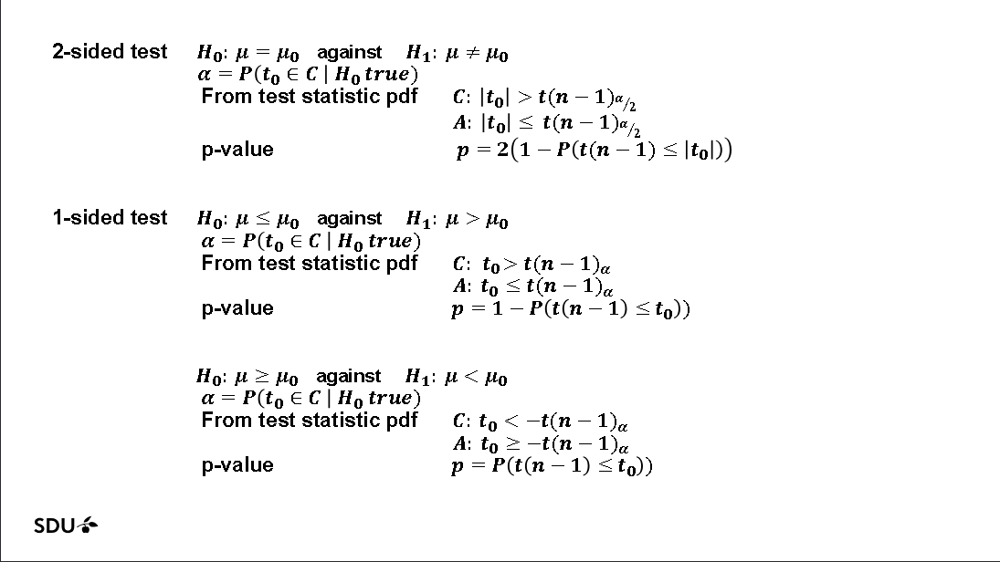</p>


<p align="center">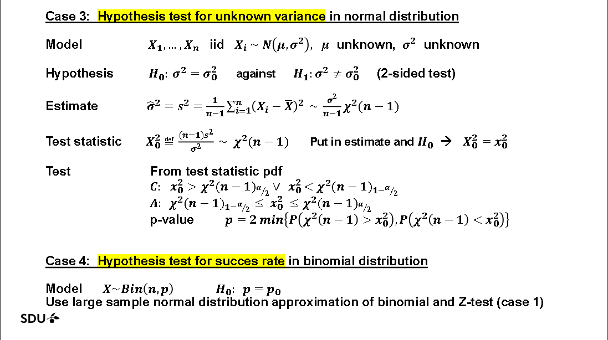</p>

### Two-sample hypothesis testing
Fra undervisning:

<p align="center">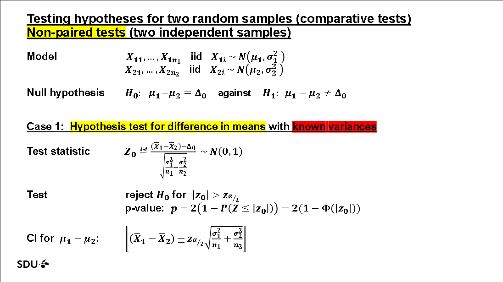</p>


<p align="center">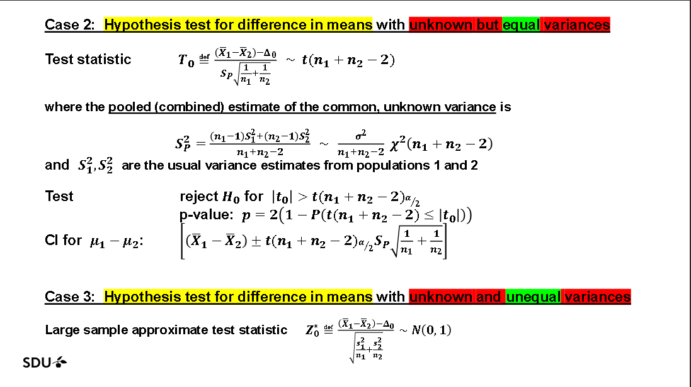</p>


<p align="center">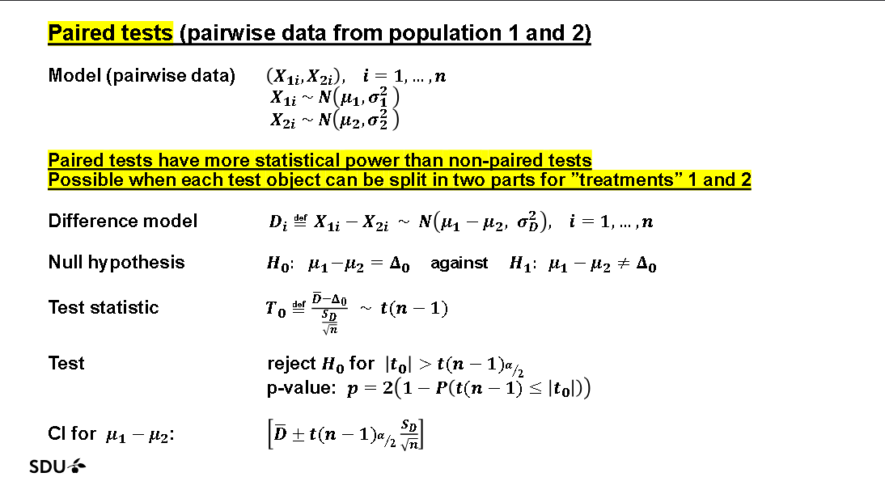</p>


<p align="center">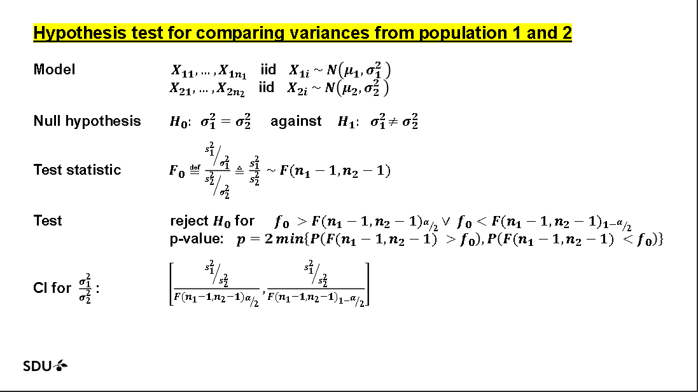</p>

- Example opg 10.2.2 
```
# example opg 10.2.2

# Consider a hypothosis test H_0 : mu_1 = mu_2 against H_1 : mu_1 neq mu_2
# suppose the sample sizes are
n1 = 15
n2 = 15

# the means are:
x1 = 4.7
x2 = 7.8

# and that 
s1 = 4
s2 = 6.25

# assume that sigma_1^2 = sigma_2^2 and the data is drawn from a normal distribution: use
alpha = 0.05

# -----------------------------------
# solution:
# -----------------------------------

result = t_test_equal_var(
    x1, x2,
    s1, s2,
    n1, n2,
    alpha
)

lower, upper = ci_difference_means_equal_var(
    x1, x2,
    s1, s2,
    n1, n2
)
```

- Output:
```
Two-sample t-test (equal variances)
t = -3.7501
p = 0.0008
df = 28
Reject H0 = True
95% CI for μ1 - μ2 = (-4.7933, -1.4067)
```


<p align="center"></p>


